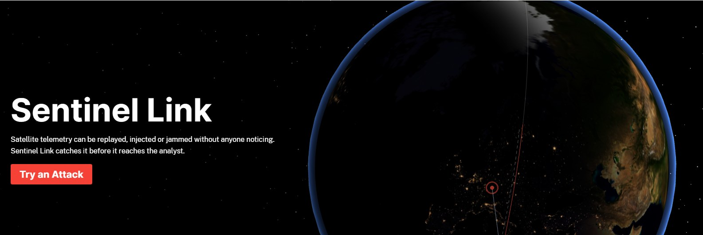
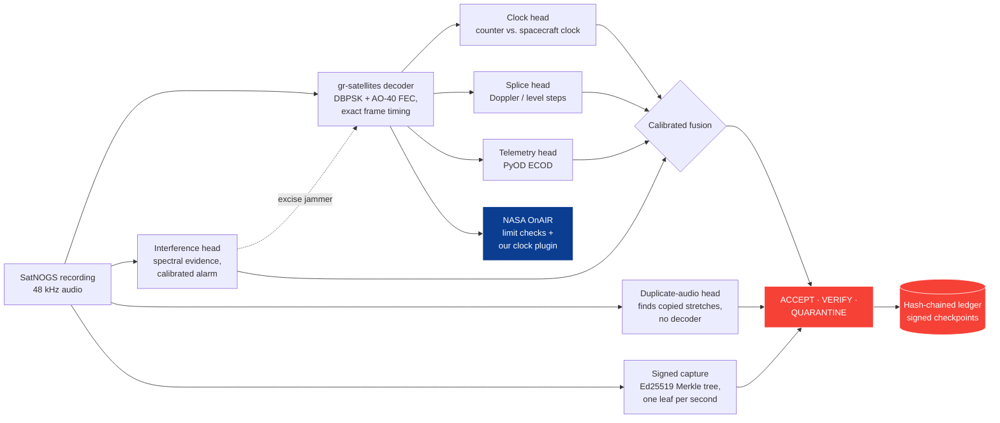
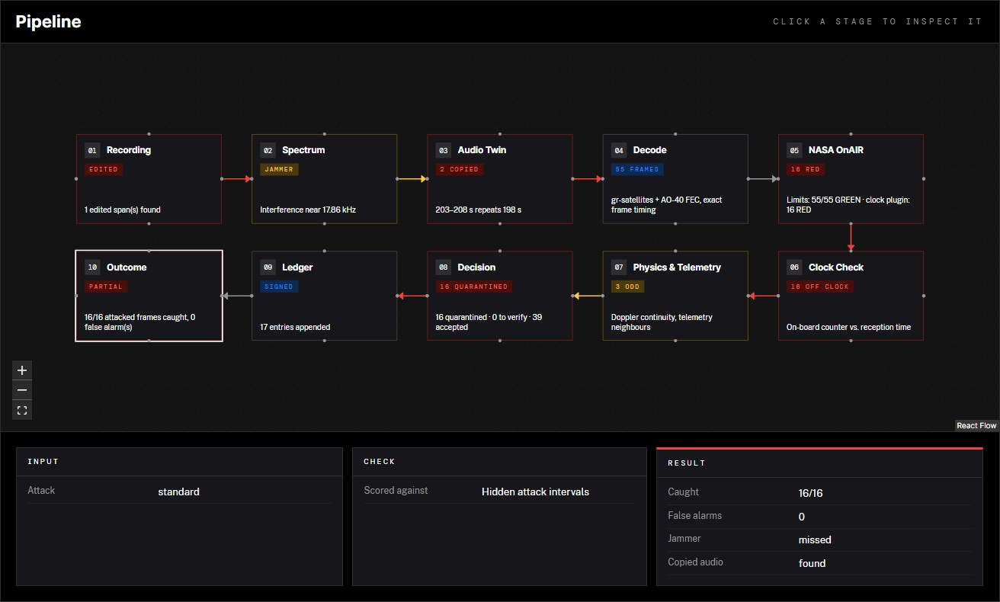

<div align="center">

# SENTINEL-LINK

**Secure ground-link testbed · TSYP14 Technical Challenge, Track 1**

*Can a stored signal or sequence be authenticated? Yes: cryptography where the link allows it, physics where it doesn't.*

<p>
  
  
  
  
  
  <br>
  
  
  
  
  
  
</p>

<p>
  <a href="#how-it-works"><b>How it works</b></a> ·
  <a href="#analyse-a-held-out-recording"><b>Analyse a recording</b></a> ·
  <a href="#results"><b>Results</b></a> ·
  <a href="#deliverables"><b>Deliverables</b></a> ·
  <a href="#installation-verification-and-deployment"><b>Deployment</b></a>
</p>



| **99.3 %** | **0.71 %** | **70 / 70** | **100 %** | **2.4 ms** |
|:---:|:---:|:---:|:---:|:---:|
| attacked frames caught | genuine frames flagged | copied audio found, no decoder | SDLS replays rejected | per frame, on a laptop |

*All measured on 17 held-out SatNOGS recordings the models never saw.*

</div>

## How it works



On a link we control, frames are protected with CCSDS SDLS instead, byte-identical to **NASA CryptoLib**.



*The web console on a held-out pass hit by the standard test: a 20-frame replay, an injected frame and a hidden
jammer. Every stage shows what it checked; here 16 of 16 attacked frames are quarantined with no false alarm.*

## Overview

SENTINEL-LINK is a defensive ground-station prototype that authenticates satellite telemetry *recordings* and the
frame sequences decoded from them, and detects the three attacks of the Track 1 standard test (**replay of a 5–20
frame subsequence, an injected sequence anomaly, and narrowband interference at a hidden SNR**) on **authentic
SatNOGS recordings**, decoded by our own chain.

Its principle: **cryptography where the link allows it, physics where it doesn't.**

| Traffic | Defence | What it gives |
|---|---|---|
| Our own command/telemetry link | CCSDS SDLS (SPI · ARSN anti-replay window · HMAC-SHA-256/128 or AES-256-GCM), HKDF key store as software trust anchor; TM frames **byte-identical to NASA CryptoLib** | Replay and injection are **rejected** |
| Recordings made by a SENTINEL station | Ed25519-signed capture manifest: per-second Merkle tree over the audio + capture context | Stored signal is **authenticated**; any edit is **localised to the second** |
| Legacy unauthenticated downlinks (all real amateur/EO cubesats) | Five detectors on evidence an attacker cannot easily fake + calibrated fusion | Replay, sequence anomaly and jamming are **detected** with a calibrated probability, then accepted / sent for verification / quarantined |
| Every decision | SHA-256 hash chain with signed checkpoints | Tamper-evident audit trail |

## Analyse a held-out recording

```bash
cd grss
py -m sentinel analyse heldout.wav --out report.json      # .ogg/.wav/.flac; start time optional
py -m sentinel analyse frames.kss                          # organizer telemetry (gr-satellites KISS)
```

It prints every quarantined / verification frame with its evidence, interference alarms with frequency, the response
chosen (excision variant that recovers the most FEC-valid frames), frames lost under jamming, and writes a signed,
hash-chained ledger. The web console's *Attack Lab → Hand us any recording* does the same from the browser.

## NASA OnAIR integration

`grss/sentinel/nasa/onair_bridge.py` streams every decoded pass through NASA OnAIR (GSFC On-board AI Research
platform, shipped in NOS3 as `components/onair`): OnAIR's own Agent and telemetry test suite evaluate each frame
against FEASIBILITY limits learned from the training passes, and our OnAIR plugin
(`sentinel/nasa/onair_plugins/sentinel_clock`) checks the frame counter against the spacecraft clock. On an attacked
pass OnAIR's limit checks stay GREEN (replayed data is physically plausible) while the clock plugin flags the replayed
frames (`tests/test_nasa_onair.py`). Set `SENTINEL_ONAIR_PATH` to an OnAIR checkout (github.com/nasa/OnAIR).

## NASA CryptoLib interoperability

`grss/sentinel/trust/cryptolib_bridge/` builds NASA CryptoLib (the CCSDS SDLS library shipped with NOS3) and a small
bridge. `tests/test_cryptolib_interop.py` shows, on real AO-73 frames: our TM-SDLS frames are byte-identical to
CryptoLib's; each side accepts the other's frames; CryptoLib rejects our forgeries. It also documents a gap: in
CryptoLib 1.7.5 anti-replay is enforced on TC only, so a replayed TM frame with a valid MAC is accepted, while our receiver
rejects it.

## The chain in detail

```
SatNOGS audio (.ogg, 48 kHz)                          ── official reference data (SatNOGS Network)
  │  capture: signed Merkle manifest (Ed25519)
  ├─► interference head: STFT → spectral kurtosis / prominence / persistence / BPSK-sideline balance
  │                      → gradient boosting + isotonic calibration → alarms (+ frequency, interval)
  │   response: notch / band-stop excision of the alarmed interferer
  ├─► duplicate-audio head: whitened 1 kHz baseband, 2 s blocks cross-correlated against the
  │                      whole file → copied stretches (replay, re-sent slot); no decoder, any satellite
  ├─► gr-satellites (GNU Radio) DBPSK demodulator  ── symbol dump + FLL (Doppler) + level tracks
  │   └─► per-block AO-40 FEC decode (sentinel)    ── each frame bound to its exact start time
  ├─► clock head      : on-board counter vs reception time, model learned from the public archive
  ├─► splice head     : carrier (Doppler) / level discontinuities, offset from smooth Doppler fit
  ├─► telemetry head  : neighbour-relative telemetry deviations scored by PyOD ECOD
  └─► fusion          : logistic regression (Platt-calibrated) → ACCEPT / VERIFY / QUARANTINE
                         → hash-chained ledger with signed checkpoints
```

### Why the clock head is so strong

FUNcube-1 / AO-73 (NORAD 39444) transmits a 256-byte frame every ~5 s. The frame type cycles 0–23 and a 24-bit
counter increments once per 24-frame set, so `P = 24·seq + type` advances exactly once per frame. A two-parameter
model `P = a + b·t` fitted on training passes gives an on-board frame period of **4.9885 s**, and predicts every
authentic frame of passes it has never seen to **within one frame** (leave-one-pass-out, all 30 observations; see
`tests/test_data_and_detectors.py`). A replayed frame lags by its replay delay; one from an earlier pass lags by
thousands of frames.

## Dataset (official reference data)

30 observations of AO-73 from the SatNOGS Network (5 stations on 3 continents, 29 Sep – 22 Oct 2026), fetched with the corrected
`norad_cat_id` filter, each with audio, station-decoded frames, TLE and station position, recorded with SHA-256 in
`grss/data/satnogs/39444/manifest.json`. Our chain recovers **1,226 frames from the raw audio vs 1,143 decoded by the
stations themselves**.

Split: training = observations before 15 Oct from stations seen more than once (13); held-out = later dates and
unseen stations (17). Every reported number is measured on the held-out set.

## Results

See [`grss/results/benchmark.md`](grss/results/benchmark.md) (generated from `benchmark.json`; nothing typed by hand).

<!-- RESULTS:START -->
Held-out SatNOGS observations: 17 · generated 2026-10-23T14:07:52+00:00

| Metric | Value |
|---|---|
| Replay + sequence-anomaly frames detected | 99.3 % (581/585) [98.3–99.7 %] |
| Events detected (standard replay · standard anomaly · cross-pass replay) | 44/44 · 41/41 · 16/16 |
| Frame false-alarm rate (attacked + clean passes) | 0.71 % [0.45–1.10 %] |
| Frame ROC-AUC · calibration error (ECE) | 0.9996 · 0.0231 |
| Evasion: counter-consistent forged frame detected | 64.7 % |
| Duplicate-audio head, no decoder: in-pass replays · duplicated slots · clean files matched | 48/48 · 22/22 · 0/30 |
| Jammed recordings detected, alarm at the jammer frequency (hidden J/S −30…+10 dB) | 54.2 % (n=48) [40.3–67.4 %] |
| Clean recordings with an interference alarm | 7/17 |
| SDLS replay / bit-flip rejection | 100.0 % / 100.0 % |
| SDLS overhead per 256 B frame | 22 B, 7.06 µs verify |
| Decision latency per frame (after decode) | 2.414 ms |
| Peak memory (benchmark process) | 43.8 MB |
<!-- RESULTS:END -->

## Reproduce

Python ≥ 3.10. Decoding needs GNU Radio + gr-satellites: on Linux `sudo apt install gnuradio gr-satellites`; on
Windows, the same inside WSL (the pipeline calls it through `wsl`).

```bash
cd grss
python -m pip install -r requirements.lock.txt
py -m sentinel fetch     # download audio, verify SHA-256 against the manifest
py -m sentinel decode    # audio -> frames + timing + Doppler (cached decodes are included)
py -m sentinel train     # models from the training split
py -m sentinel bench     # held-out benchmark -> results/benchmark.json
py -m sentinel.bench.report
py -m pytest tests
```

Web console (Next.js + three.js):

```bash
py -m sentinel serve                 # API on :8000
cd frontend && npm ci && npm run dev   # http://localhost:3000
```

## Deliverables

| # | Deliverable | Document |
|---|---|---|
| | Compliance matrix (every requirement → evidence) | [`grss/docs/00_compliance_matrix.md`](grss/docs/00_compliance_matrix.md) |
| 1 | Threat model & segment analysis | [`grss/docs/01_threat_model.md`](grss/docs/01_threat_model.md) |
| 2 | Platform, architecture & trust anchor | [`grss/docs/02_architecture_trust_anchor.md`](grss/docs/02_architecture_trust_anchor.md) |
| 3 | Signal processing | [`grss/docs/03_signal_processing.md`](grss/docs/03_signal_processing.md) |
| 4 | AI & statistical detection | [`grss/docs/04_detection.md`](grss/docs/04_detection.md) |
| 5 | Adversarial validation & response | [`grss/docs/05_adversarial_validation.md`](grss/docs/05_adversarial_validation.md) |
| 6 | Official reference data & reproducibility | [`grss/docs/06_dataset_and_reproducibility.md`](grss/docs/06_dataset_and_reproducibility.md) |
| | Technical report, 8 pages | [`grss/results/report/technical/SENTINEL-LINK_technical_report.pdf`](grss/results/report/technical/SENTINEL-LINK_technical_report.pdf) |
| | Phase 1 report (generated) | `grss/results/report/SENTINEL-LINK_report.pdf` (`py -m sentinel.bench.paper`) |

## Repository map

| Path | Content |
|---|---|
| `grss/sentinel/data` | SatNOGS client, decoded corpus |
| `grss/sentinel/decode` | gr-satellites runner, per-block AO-40 decoder, KISS, AO-73 frame parser |
| `grss/sentinel/dsp` | audio I/O, carrier estimate, spectral evidence, interference excision |
| `grss/sentinel/detect` | clock, splice, telemetry, interference heads; fusion |
| `grss/sentinel/trust` | SDLS emulation, Merkle tree, signed capture manifest, hash-chained ledger |
| `grss/sentinel/redteam` | attacks on real audio and frame streams; standard scenario + evasion variants |
| `grss/sentinel/bench` | held-out benchmark and report |
| `grss/sentinel/api` | FastAPI service for the console |
| `grss/sentinel/db.py` | PostgreSQL storage: append-only ledger, runs, per-frame decisions |
| `grss/frontend` | web console |

## Tools and standards

SatNOGS Network (data) · gr-satellites / GNU Radio (demodulation, AO-40 FEC) · PyOD (ECOD) · scikit-learn ·
CCSDS 355.0-B-2 SDLS (modelled after NASA CryptoLib's frame layout) · C2PA-style signed provenance manifest ·
SGP4 (pass geometry from the observation's TLE).

## Faster simulation replays

The API caches scenario, pass, sample, and OnAIR analysis in memory and on disk. Keys include recording/model/source contents and attack parameters. Every replayed result still gets fresh run identity, current-station capture signing, and new audit entries. See [cache configuration](grss/frontend/README.md#simulation-cache).

On the measured AO-73 standard scenario, HTTP response time fell from **15.82 s to 0.197 s** on a memory hit (**80.5x**); a disk hit after restarting the API took **0.288 s** with a new station signer. These are replay-serving times, separate from detector latency. Measurements: [cache_performance.json](grss/results/cache_performance.json).

The regenerated [Phase 1 report](grss/results/report/SENTINEL-LINK_report.pdf) includes the completed held-out benchmark and measured detector limitations.

## Installation verification and deployment

See [the deployment guide](grss/deploy/README.md) for native Windows/Linux setup, pinned NASA module installation, and Docker Compose. The app proxies API requests through the web origin and includes a standalone production launcher.

In production the decision ledger, run history and per-frame decisions are stored in **PostgreSQL**: an append-only ledger table enforced by trigger, one transaction per run, and an API role that can only read and insert ([production storage](grss/deploy/README.md#production-storage-postgresql)). Without `SENTINEL_DATABASE_URL` the system runs entirely on files, so the benchmark reproduces with no database installed.

```sh
cd grss
python -m sentinel doctor --verify-data --require-nasa
python deploy/verify_clean.py --smoke --out results/clean_install.json
```

A fresh Linux Python 3.13 environment passed all 38 tests and the real API smoke suite with both NASA integrations. A separate frontend source copy passed `npm ci` and its production build. Evidence: [Linux verification](grss/results/clean_install.json), [frontend verification](grss/results/frontend_clean_install.json). The Linux check reuses the public recordings as inputs and verifies their hashes; it does not reuse the existing Python environment or source tree.
