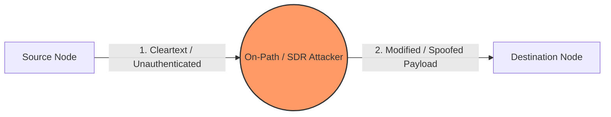
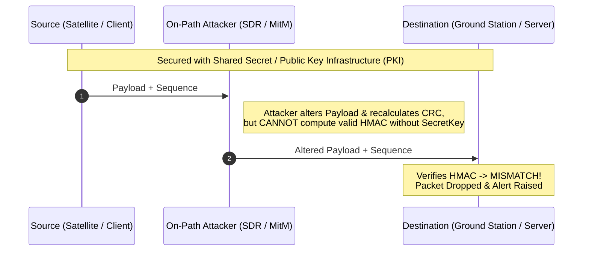

# Cybersecurity in Networking: Traffic Interception & Defensive Controls

> [!abstract] Core Premise
> Any communication channel between a **Source (`Src`)** and a **Destination (`Dest`)**—whether a local Ethernet LAN, the public internet, or an RF satellite downlink—is vulnerable to interception, spoofing, and alteration if data is transmitted in **cleartext** without cryptographic verification.

---

## 1. On-Path / Man-in-the-Middle (MitM) Attacks

For an intermediary to read or alter a message in transit, they must position themselves directly along the communication path between `Src` and `Dest`. 

### 1.1 Terrestrial Network Interception Vectors
* **[[ARP Spoofing]] (Layer 2 - Data Link):** Broadcasting falsified Address Resolution Protocol messages on a Local Area Network (LAN) to link the attacker's MAC address with the default gateway's IP address. All local traffic is silently routed through the attacker's machine before reaching the router.
* **[[DNS Spoofing]] / Cache Poisoning (Application/Network):** Corrupting Domain Name System records so the `Src` resolves a legitimate domain name to a malicious IP address controlled by the attacker.
* **[[Intercepting Proxies]] (Layer 7 - Application):** Routing traffic through an intermediary inspection proxy (e.g., *Burp Suite*, *Charles Proxy*, *mitmproxy*). Used legitimately by developers for debugging API calls, or maliciously to modify HTTP requests and responses in transit.

### 1.2 RF & Space-Ground Interception Vectors (Case Study: Legacy CubeSats)
Wireless and satellite links—such as Earth Observation (EO) CubeSats downlinking telemetry to crowdsourced **[[SatNOGS]]** ground stations—are inherently broadcast mediums. Anyone within the radio footprint with an antenna can receive or transmit.

* **Vulnerability Context:** Legacy CubeSats often downlink telemetry (battery voltage, thermal data, attitude) in **cleartext** without cryptographic **Message Authentication Codes (MACs)** to save power and compute.
* **Adversarial Profile (Tier-2 Threat):** Equipped amateur or malicious actor using commodity **Software-Defined Radios (SDRs)** (e.g., *HackRF*, *USRP*), *Universal Radio Hacker (URH)*, and Python, operating **without** master cryptographic keys.

#### STRIDE Threat Taxonomy on Unauthenticated Links
| Threat ID | Attack Vector | STRIDE Category | Technical Mechanism | Operational Impact |
| :--- | :--- | :--- | :--- | :--- |
| **T1** | **Subsequence Replay** | Spoofing / Tampering | Splicing and re-broadcasting 5–20 valid telemetry frames recorded from historical passes. | Conceals active spacecraft faults by making the satellite appear nominal to ground operators. |
| **T2** | **Frame Sequence Injection** | Spoofing / Tampering | Crafting fabricated telemetry payloads with valid recalculated CRCs, inverting sequence counters, or bursting duplicate frames. | Corrupts ground telemetry databases, desynchronizes state tracking, or triggers false alarms. |
| **T3** | **Narrowband Interference** | Denial of Service (DoS) | Digitally injecting on-carrier or off-carrier Continuous Wave (CW) tones and low-SNR noise. | Degrades Signal-to-Noise Ratio (SNR) to cause packet drops or mask the transition into a T1/T2 spoofing attack. |

> [!warning] Security Pitfall: CRC $\neq$ Cryptographic Integrity
> A **Cyclic Redundancy Check (CRC)** is designed strictly to detect accidental bit-flips caused by noisy communication channels. Because the CRC polynomial is public and requires no secret key, an attacker using Python can trivially recalculate a valid CRC for a modified or forged packet in microseconds.

---

## 2. Defensive Cryptography: Preventing Alteration

Modern network protocols enforce the **CIA Triad** (Confidentiality, Integrity, Availability) alongside **Authenticity** and **Non-Repudiation** so that messages cannot be read, forged, or modified undetected.

### Core Cryptographic Controls

| Defense Mechanism | Security Property | How It Protects the Link | Standards & Protocols |
| :--- | :--- | :--- | :--- |
| **[[Transport Layer Security (TLS)]]** | Confidentiality & Integrity | Encrypts data in transit end-to-end. Even if an attacker intercepts the packet, they only see ciphertext and cannot alter the payload without breaking session keys. | `TLS 1.3`, `HTTPS`, `QUIC`, `IPsec`, `CCSDS SDLS` |
| **[[Cryptographic Hash Functions]]** | Integrity | Generates a fixed-size mathematical digest of the data. Altering even a single bit changes the entire hash output via the avalanche effect. | `SHA-256`, `SHA-3`, `BLAKE3` |
| **[[Message Authentication Code (MAC)]]** | Integrity & Authenticity | Appends a cryptographic tag computed from both the message and a secret key: $\text{Tag} = \text{MAC}(K, M)$. Directly mitigates **T2 Frame Injection**. | `HMAC-SHA256`, `AES-GCM` (AEAD), `ChaCha20-Poly1305` |
| **[[Digital Signatures]]** | Authenticity & Non-Repudiation | `Src` signs the message digest using its **Private Key**; `Dest` verifies the signature using the `Src`'s **Public Key**. Guarantees sender identity and data integrity. | `Ed25519`, `ECDSA`, `RSA-PSS` |
| **[[Authenticated Sequence Counters]]** | Anti-Replay Protection | Monotonically increasing counters or timestamps protected inside a MAC or encrypted frame. Directly mitigates **T1 Subsequence Replay**. | `IPsec Anti-Replay Window`, `CCSDS Security Header` |

---

## 3. AI in Defensive Network & Security Engineering

Frontier reasoning models (such as **[[Gemini 4 Argon]]**) are increasingly utilized in defensive cybersecurity and secure systems engineering:

* **Autonomous Vulnerability Patching & Code Auditing:** Utilizing 1-million-token context windows to analyze entire network protocol stacks, identify missing authentication checks, and patch logic flaws or zero-day vulnerabilities before deployment.
* **Access-Control & Protocol Verification:** Auditing state machines to verify that sequence counters, CRCs, and cryptographic MACs are properly validated before telemetry or network payloads are ingested.
* **Legacy Code Refactoring:** Migrating memory-unsafe legacy codebases (such as C, C++, or Fortran used in older aerospace and networking infrastructure) into memory-safe languages like **Rust** to eliminate buffer overflows.
* **Indirect Prompt Injection (IPI) Resilience:** Hardening autonomous security agents that inspect untrusted network traffic or logs against embedded adversarial instructions (measured via benchmarks like Gray Swan IPI).

---

## 4. Review & Actionable Checklist for Secure Links

- [ ] **Eliminate Cleartext Protocols:** Replace unencrypted transport (`HTTP`, `Telnet`, raw RF frames) with authenticated and encrypted channels (`TLS 1.3`, `SSH`, `CCSDS SDLS`).
- [ ] **Authenticate Every Frame:** Never rely on a `CRC` for security; mandate `HMAC` or Authenticated Encryption with Associated Data (`AEAD`) on all packets.
- [ ] **Bind Sequence Numbers to MACs:** Ensure frame sequence counters are included inside the MAC calculation to prevent **T1 Subsequence Replay** and **T2 Sequence Inversion**.
- [ ] **Monitor Physical & Link Layers:** Track SNR anomalies, carrier offsets, and sudden CRC error spikes to detect **T3 Narrowband Interference** and on-path jamming early.

---

## Related Vault Links
* [[threat_model.md — Space-Ground Segment Analysis]]
* [[OSI Model & Layer Security]]
* [[Software-Defined Radio (SDR) & RF Security]]
* [[Public Key Infrastructure (PKI) & Key Management]]